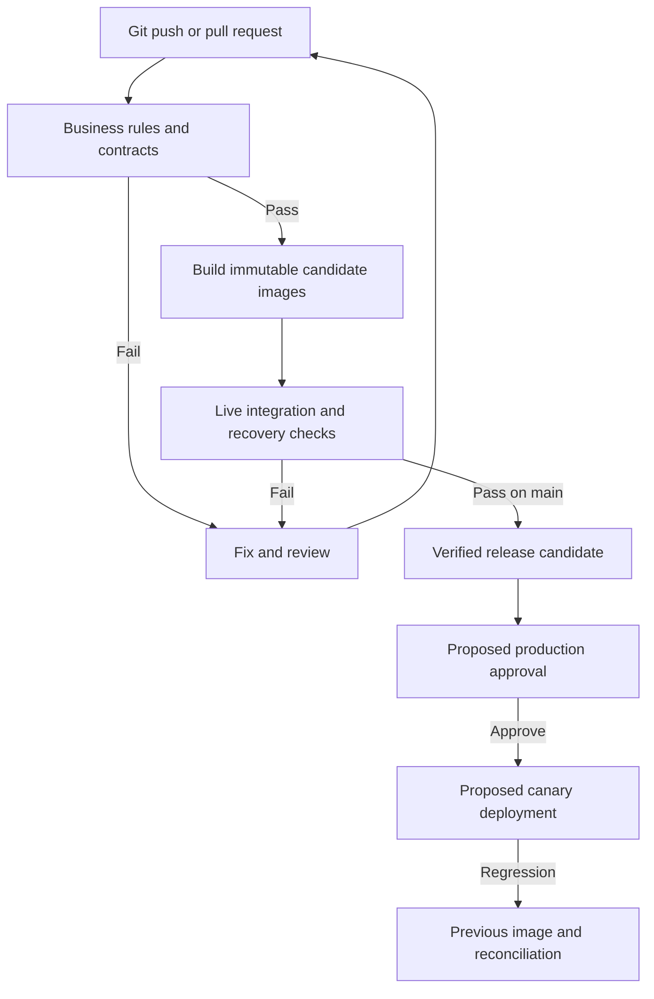

# Delivery design and implemented pipeline

## Implemented scope

`.github/workflows/ci.yml` runs on main pushes and pull requests, with a manual rerun option. It has three jobs:

1. **Business rules and contract tests:** checkout the triggering revision; select Python 3.12; install the pinned dependency; compile source; run twenty-one tests; preserve actual output.
2. **Build once and verify live services:** build each runtime image once with its full source SHA and OCI revision label; record immutable local image IDs; start the same images with `--no-build`; run real messaging, restart and broker-outage checks; preserve service logs/manifest; clean up ephemeral CI resources.
3. **Release candidate verified:** on main outside pull requests, retrieve this run's manifest, check its revision/service list and identify the delivery boundary in the summary.

The pipeline does not deploy production, publish registry images or measure production SLOs. Local image IDs are not registry manifest digests. Candidate verification is a release-readiness checkpoint, not a human approval gate. Artifacts contain small logs/metadata, not large image archives.

## Production extension proposed for MaltaShop

Choose continuous delivery initially. Twelve developers and two operations staff can automate preparation and verification while retaining an approved production release. Short-lived reviewed branches keep main releasable. Require checks before merging; those protections must be configured in MaltaShop's organisation rather than assumed to exist on the student's repository.

Production adds an immutable registry, image/dependency vulnerability scanning, SBOM/signature verification, isolated staging, approved database migrations, protected approval and deployment to an actual managed runtime. Promote tested image digests rather than rebuilding. Inject environment configuration and service identities separately. Keep a previous verified image and compatible schema for rollback. Payment rollout uses a limited canary with automatic stop/rollback on payment/checkout error or latency regressions, and reconciliation for in-flight authorizations. Reverting an image does not reverse a payment or migration.

Caption: The prototype executes through candidate verification. Production approval, registry-backed promotion, canary rollout and rollback are proposed additions. Failed checks prevent readiness; a new reviewed commit repeats validation. The diagram distinguishes actual evidence from future production capability.

## Pipeline risks and controls

- Actions use verified full commit pins. Updates require review.
- Tokens have `contents: read`; checkout does not persist credentials. No `pull_request_target` execution or production secret enters PR checks.
- Untrusted code still runs on ephemeral hosted runners. Keep deployment credentials outside those jobs; never promote untrusted workflow artifacts.
- Time limits bound stuck jobs. New commits cancel older runs on the same ref. Artifact names include the revision and retention is seven days.
- Pika is pinned. Base-image tags and hosted runners remain mutable; production should pin and scan them. No completed CVE scan, signing or SBOM gate is claimed.
- Logs are preserved on failure. Cleanup deletes only the runner's ephemeral test volumes, not the student's local volumes.

## Evidence and startup tolerance

Preserve workflow source and a genuine passing summary showing repository, revision and three successful jobs. Green checks prove those specified tests passed, not 99.9% production availability or ten-times capacity.

Initial local RabbitMQ startup reported unhealthy; later listener logs and a retry became healthy. No out-of-memory cause was established. Stage 3 increases startup grace/probe tolerance for slow first startup without suppressing health checks. Live tests still require actual message delivery.
